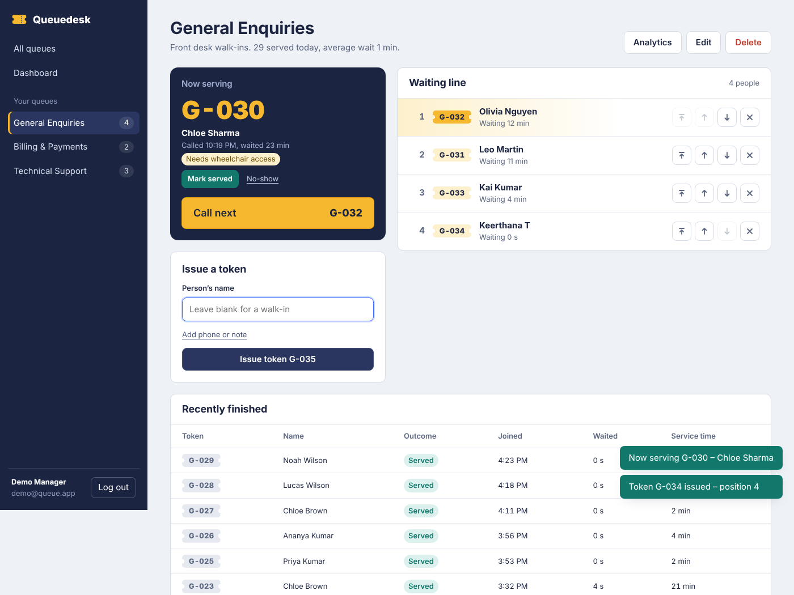
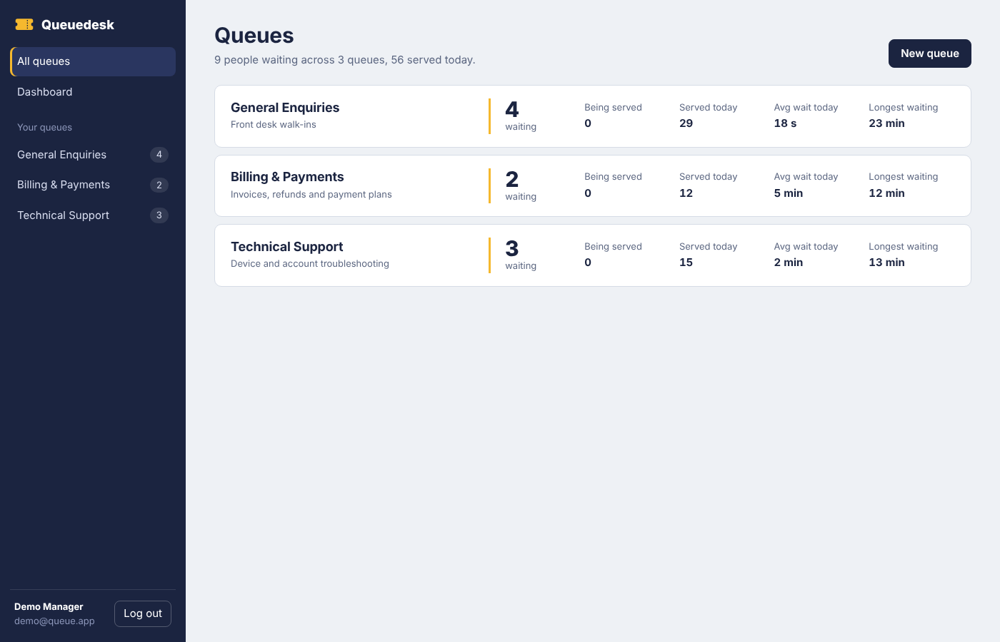
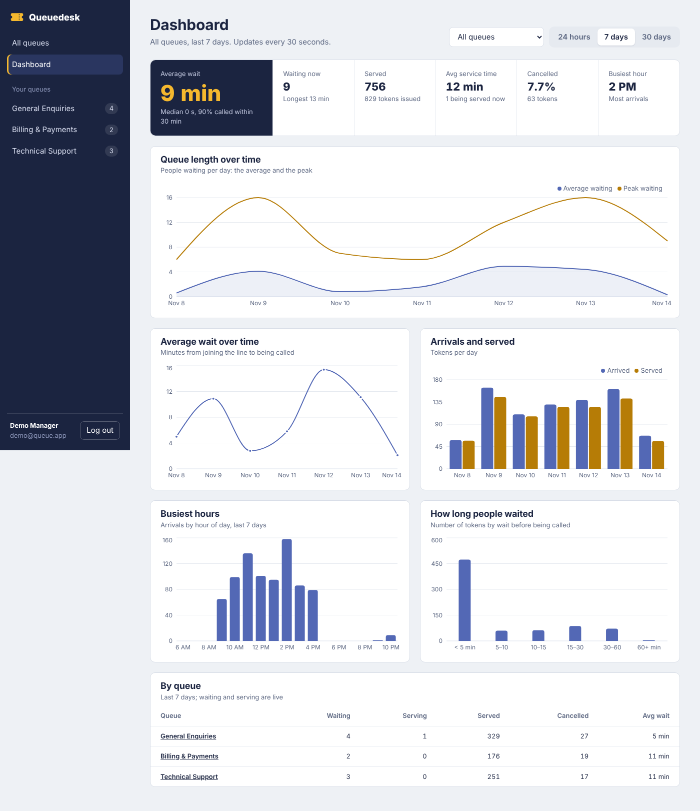
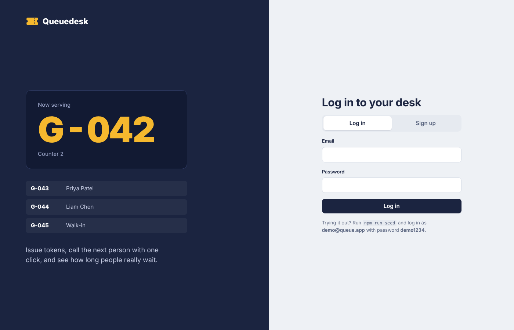
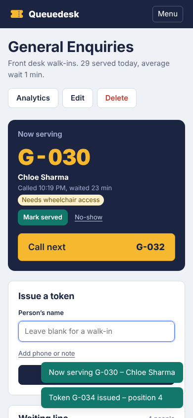

# Queuedesk — Queue Management Application

A full-stack queue management app for service counters. A queue manager logs in, creates queues, issues tokens to people as they arrive, reorders the line, calls the next person with one click, cancels tokens, and tracks wait times and queue trends on an analytics dashboard.



## Features

| Requirement | How it works |
| --- | --- |
| 1. Manager login and queue creation | Email + password accounts (bcrypt-hashed, JWT sessions). Each manager sees only their own queues. **New queue** creates one. |
| 2. Each queue has a name | Name (unique per manager), optional description, and a token prefix (auto-derived, e.g. *Billing Desk* → `BD`). Queues can be renamed or deleted. |
| 3. Add people / tokens | **Issue a token** with an optional name, phone and note. Each one gets a code like `G-007`. Numbers restart every day once the previous day's line has cleared. |
| 4. Display the waiting line | The waiting line shows position, token, name, note and a live "waiting X min" timer. It refreshes every 5 seconds. |
| 5. Move tokens up and down | Up / down buttons on every row, plus move-to-top. Buttons are disabled at the ends of the line. |
| 6. Serve the top token | **Call next** moves the first person in line to *Now serving*. **Mark served** finishes the service, which records service time. |
| 7. Cancel a token | The ✕ button cancels a waiting token (with an optional reason) after confirmation. A person being served can be cancelled as a **No-show**. |
| 8. Analytics dashboard | Average, median and 90th-percentile wait; people waiting now and the longest current wait; service time; cancellation rate; queue length over time (average and peak); wait trend; arrivals vs served; busiest hours; wait-time distribution; per-queue table. You can filter by queue and by 24 hours, 7 days or 30 days. |

Also included: a responsive layout down to phone width, keyboard-accessible controls with visible focus, toasts for every action, confirmation dialogs for destructive actions, a demo-data seeder, and 20 automated backend tests.

## Screenshots

| Queues | Dashboard |
| --- | --- |
|  |  |

| Login | Mobile |
| --- | --- |
|  |  |

## Tech stack

- **Frontend:** React 18, React Router, Recharts, Vite, and hand-written CSS (no UI kit)
- **Backend:** Node.js, Express, JSON Web Tokens, bcryptjs
- **Storage:** a JSON file (`server/data/db.json`) written atomically. There are no native modules and no database to install.
- **Tests:** Node's built-in test runner (`node --test`)

## Getting started

Requires **Node.js 18 or newer**.

```bash
git clone https://github.com/keerthanathummala/queue-management-application.git
cd queue-management-application
npm install            # installs the root dev tool (concurrently)
npm run install:all    # installs server and client dependencies
npm run seed           # optional: demo account with 30 days of history
```

### Development (hot reload)

```bash
npm run dev
```

Open **http://localhost:5173**. The Vite dev server proxies `/api` to the Express server on port 4000.

### Production

```bash
npm run build   # builds the React client into client/dist
npm start       # Express serves the API and the built client
```

Open **http://localhost:4000**.

### Demo account

After `npm run seed`, log in with **demo@queue.app** / **demo1234**. Or click **Sign up** to create your own manager account.

### Tests

```bash
npm test
```

### Configuration

| Variable | Default | Purpose |
| --- | --- | --- |
| `PORT` | `4000` | API / app port |
| `JWT_SECRET` | dev-only value | **Set this in production** |
| `DATA_FILE` | `server/data/db.json` | Where data is stored |

## API

All endpoints except register and login need an `Authorization: Bearer <token>` header.

| Method | Endpoint | Description |
| --- | --- | --- |
| POST | `/api/auth/register` | `{ name, email, password }` → `{ token, user }` |
| POST | `/api/auth/login` | `{ email, password }` → `{ token, user }` |
| GET | `/api/auth/me` | Current manager |
| GET | `/api/queues` | Your queues with live counts |
| POST | `/api/queues` | `{ name, description?, prefix? }` |
| GET | `/api/queues/:id` | Queue, waiting line, now serving, recent history |
| PATCH | `/api/queues/:id` | Rename / edit |
| DELETE | `/api/queues/:id` | Delete the queue and its tokens |
| POST | `/api/queues/:id/tokens` | `{ name?, phone?, note? }` issues a token |
| POST | `/api/queues/:id/serve-next` | Calls the top token for service |
| POST | `/api/tokens/:id/move` | `{ direction: "up" \| "down" \| "top" \| "bottom" }` |
| POST | `/api/tokens/:id/complete` | Marks a serving token as served |
| POST | `/api/tokens/:id/cancel` | `{ reason? }` cancels a waiting or serving token |
| GET | `/api/analytics` | `?range=24h\|7d\|30d&queueId=&tzOffset=` |

Errors come back as `{ "error": "message" }` with the right status code: 400 for invalid input, 401 when not logged in, 404 when not found or not yours, and 409 for an action that conflicts with the token's current state.

## Project structure

```
├── client/                 React app (Vite)
│   └── src/
│       ├── pages/          Login, Queues, Queue desk, Dashboard
│       ├── components/     Layout, modals, ticket stub, toasts, forms
│       ├── api.js          fetch wrapper with auth
│       └── styles.css      design tokens and all styles
├── server/
│   ├── src/
│   │   ├── app.js          Express app
│   │   ├── auth.js         register / login / JWT middleware
│   │   ├── queues.js       queue and token endpoints
│   │   ├── analytics.js    analytics computation
│   │   ├── db.js           JSON-file persistence
│   │   └── seed.js         demo-data simulator
│   └── test/               API and analytics tests
└── docs/screenshots/
```

## How the analytics are calculated

- **Wait time** is the time from a token being issued to it being called for service.
- **Service time** is the time from being called to being marked served.
- **Queue length** is the number of tokens in the waiting line at a moment. Each hour or day is sampled across its active period to get the average and the peak.
- Hour and day buckets use the viewer's time zone.

## Author

Keerthana Thummala
